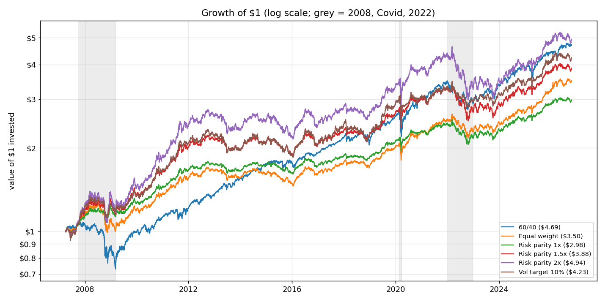
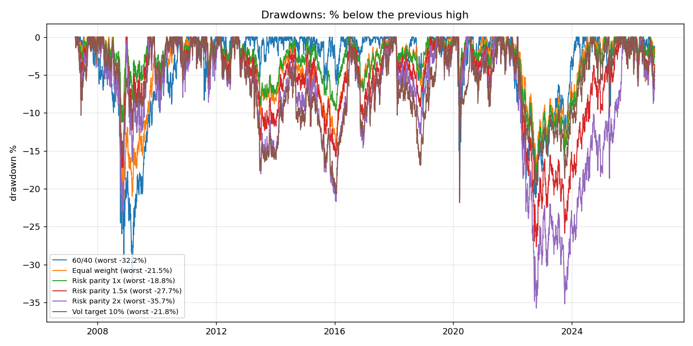
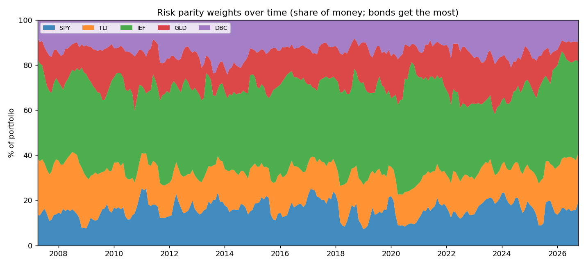
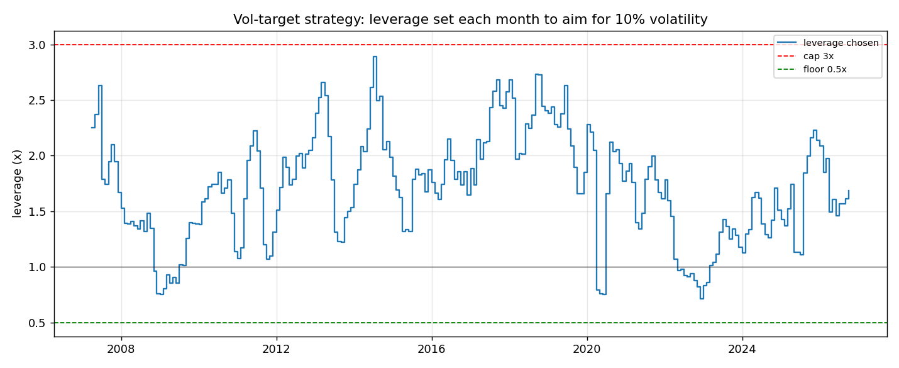
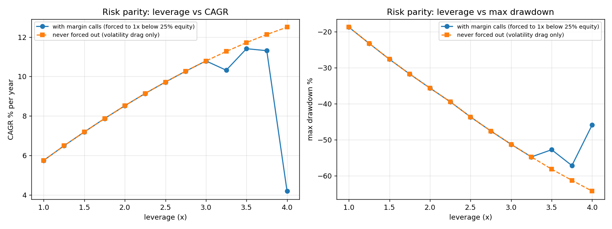

# Leveraged risk parity: how much leverage is too much?

A Python backtest of a **risk parity** portfolio (stocks, bonds, gold and commodities) run with leverage, with
realistic borrowing costs, trading costs and **margin calls**. Daily data, 2007 to October 2026.

**Question:** can a risk parity portfolio safely use leverage, and at what point does leverage stop helping?

**Short answer:** about 2x is the practical limit. Leverage raised returns up to about 3.5x, but drawdowns grew in step
(−36% at 2x, −51% at 3x). Each extra 1x of borrowing lowered the Sharpe ratio, because borrowing costs more than
the risk-free rate. Above about 3.25x, **margin calls** started forcing the portfolio to sell near the bottom. At 4x
they cut the annual return from 12.5% to 4.2%. And in 2022, when stocks and bonds fell together, 2x risk parity lost
25%, more than a plain 60/40 portfolio.

---

## 1. The idea in one story

A normal 60/40 portfolio puts 60% of the **money** in stocks. But stocks move about 3 times as much as mid-term bonds
(19.5% vs 6.9% volatility a year), so almost all of the portfolio's **risk** comes from stocks. Over 2007-2026,
stocks carried about 100% of 60/40's risk; the bonds slightly reduced it, because they tended to move the other way.
In practice, 60/40 is a stock portfolio with some bonds attached.

Risk parity gives each asset the same share of risk instead. Calm assets need more money to matter, so **bonds get
most of the money** (about 55% here) and stocks only about 16%. The result is very stable, but its return is low.

The usual solution is to **borrow** to scale the stable portfolio up to a useful return. This project tests that
step: how much leverage is safe once you pay for the borrowing and the broker can force you to sell?

## 2. Method

| | |
|---|---|
| **Assets** | SPY (US stocks), TLT (20+ year Treasuries), IEF (7-10 year Treasuries), GLD (gold), DBC (commodities) |
| **Data** | Yahoo Finance daily adjusted closes (dividends included), 2007-01-03 to 2026-10-16. 0 missing ETF prices; 2 missing T-bill days filled with the previous day |
| **Rebalancing** | First trading day of each month, at the close. Weights use **only data up to the previous day's close** (no lookahead; tested) |
| **Borrowing cost** | 3-month T-bill yield (^IRX) + 1% a year on the borrowed amount, charged daily. Spare cash (leverage below 1x) earns the T-bill rate |
| **Trading cost** | 5 basis points (0.05%) on every dollar traded |
| **Margin call** | If equity / total exposure falls below 25% (leverage above 4x), the position is forced down to 1x at that day's close and stays at 1x until the next monthly rebalance |

**Strategies**
1. **60/40**: 60% SPY, 40% IEF.
2. **Equal weight**: 20% in each asset.
3. **Risk parity 1x**: weight each asset by 1 / (its 60-day volatility), scaled to sum to 100%.
4. **Risk parity 1.5x and 2x**: the same mix, scaled up with borrowed money.
5. **Vol target 10%**: risk parity weights, with leverage reset each month so the *expected* volatility (from the
   last 60 days, including how the assets move together) is 10% a year. Leverage is kept between 0.5x and 3x.

## 3. Results (April 2007 to October 2026)

| Strategy | CAGR | Volatility | Sharpe | Sortino | Max drawdown | Calmar | Worst year | Longest recovery | Borrow cost/yr |
|---|---|---|---|---|---|---|---|---|---|
| 60/40 | 8.23% | 11.0% | **0.64** | **0.91** | −32.2% | 0.26 | −17.7% (2008) | 2.8 yrs | – |
| Equal weight | 6.63% | 8.5% | 0.62 | 0.88 | −21.5% | 0.31 | −9.9% (2022) | 3.7 yrs | – |
| Risk parity 1x | 5.75% | **7.0%** | 0.62 | 0.88 | **−18.8%** | 0.31 | −11.6% (2022) | **2.5 yrs** | – |
| Risk parity 1.5x | 7.19% | 10.5% | 0.57 | 0.81 | −27.7% | 0.26 | −18.5% (2022) | 3.7 yrs | 1.25% |
| Risk parity 2x | **8.52%** | 14.1% | 0.54 | 0.78 | −35.7% | 0.24 | −25.1% (2022) | 3.8 yrs | 2.50% |
| Vol target 10% | 7.67% | 11.2% | 0.58 | 0.81 | −21.8% | **0.35** | −11.8% (2022) | 3.8 yrs | 1.68% |

Sharpe and Sortino are measured above the T-bill rate. Trading costs were below 0.13% a year for every strategy. None
of these six strategies had a margin call. The vol-target strategy's leverage ranged from 0.72x to 2.89x and never
reached its cap or floor. All numbers are in [results.csv](results.csv).

### Stress periods (return over the period)

| Strategy | 2008 crisis (Oct 2007 – Mar 2009) | Covid crash (Feb – Mar 2020) | 2022 rate shock (calendar year) |
|---|---|---|---|
| 60/40 | **−31.9%** | −18.4% | −16.6% |
| Equal weight | −6.1% | −9.0% | −9.9% |
| Risk parity 1x | +7.7% | −5.7% | −11.6% |
| Risk parity 1.5x | +9.0% | −8.6% | −18.5% |
| Risk parity 2x | +9.7% | −11.4% | **−25.1%** |
| Vol target 10% | +11.9% | −11.8% | −11.8% |

The stress periods were chosen from well-known market dates (the S&P 500 peak and bottom, and calendar 2022), not by
looking at these results.

### Leverage curve: risk parity at 1x to 4x

| Leverage | 1x | 1.5x | 2x | 2.5x | 3x | 3.25x | 3.5x | 3.75x | 4x |
|---|---|---|---|---|---|---|---|---|---|
| CAGR with margin calls | 5.75% | 7.19% | 8.52% | 9.72% | 10.79% | 10.32% | **11.41%** | 11.31% | **4.19%** |
| CAGR, never forced out | 5.75% | 7.19% | 8.52% | 9.72% | 10.79% | 11.27% | 11.72% | 12.13% | 12.50% |
| Max drawdown (never forced out) | −18.8% | −27.7% | −35.7% | −43.7% | −51.3% | −54.8% | −58.2% | −61.3% | −64.3% |
| Sharpe | 0.62 | 0.57 | 0.54 | 0.53 | 0.52 | 0.48 | 0.51 | 0.50 | 0.25 |
| Margin calls | 0 | 0 | 0 | 0 | 0 | 2 | 7 | 42 | 197 |

The Sharpe row is for the version with margin calls. Every 0.25x step is in [leverage_curve.csv](leverage_curve.csv).

**Why returns rise and then fall (volatility drag).** The yearly growth rate at leverage L is roughly:

> L × average return  −  (L − 1) × borrowing rate  −  L² × variance / 2

The first two terms grow in a straight line, but the last one grows with **L squared**: doubling leverage doubles the
return but *quadruples* the drag. This is because losses hurt compounding more than gains help it: a −50% year needs
+100% to get back to even. For this portfolio (5.8% average return, 2.5% average borrowing cost, 7% volatility), the
formula puts the peak at about 6.8x. Simulated without margin calls, CAGR peaks at 6.0x (14.1%).

Risk parity is so calm that **volatility drag alone does not turn returns down before 4x**. The orange line in the
chart below keeps rising. Inside 1x-4x, what breaks leverage is the **margin call**. At 3.25x, two forced sales near
the bottom left it behind 3x. At 4x, the portfolio starts exactly on the 25% margin line, gets forced out 197 times,
and ends up below 1x. Margin calls make you sell after the fall and miss the rebound.

## 4. Charts

**Growth of $1** (log scale; grey bands = 2008, Covid, 2022)


**Drawdowns**: how far each strategy is below its previous high


**Risk parity weights over time**: IEF and TLT together hold about half the money


**Vol-target leverage over time**: cut to 0.75x after the 2008 crash and Covid, below 1x for most of 2022


**Leverage curve**


## 5. What broke in 2022, and why

Risk parity is a bet that **bonds rise when stocks fall**. From 2007 to 2021 that was true: the daily correlation
between SPY and TLT was −0.43, and in 2008 it was −0.48. That is why risk parity *made* money in 2008 while 60/40 lost
32%.

In 2022, inflation hit 9% and the Federal Reserve raised rates from about 0% to over 4% in one year. Rising rates push
bond prices down, so **bonds fell together with stocks**. The SPY-TLT correlation turned positive (+0.08), and in 2022:

| SPY | TLT | IEF | GLD | DBC |
|---|---|---|---|---|
| −18.2% | **−31.2%** | −15.2% | −0.8% | +19.3% |

Three things hit the levered risk parity portfolio at once:
1. **Its biggest holdings were the worst performers.** About 52% of the money was in TLT and IEF, which lost 31% and
   15%. The weights were set for calm bond markets, so the portfolio was most exposed exactly where the shock came.
2. **Leverage multiplied a loss that diversification was supposed to prevent.** 1x lost 11.6%, 2x lost 25.1%, worse
   than 60/40 (−16.6%).
3. **Borrowing got expensive.** The T-bill rate went from 0.03% to 4.26% during the year, so the cost of the borrowed
   half rose from about 1% to over 5% a year.

The vol-target version did much better (−11.8%). As volatility rose, it cut leverage from 1.78x in January to 0.97x by
May and 0.72x by December. That reaction cuts both ways: before Covid, after a calm 2019, it was **at 2.2x**, and
monthly rebalancing meant it only cut leverage in April, after the crash. Volatility targeting protects against slow
crises, not sudden ones.

## 6. Limitations

- **US data only.** One country's stocks and bonds, through one long bond bull market (2007-2020) and one sharp rise
  in interest rates. Other countries or decades (e.g. 1970s inflation) could look very different.
- **History starts in 2007**, because of when the ETFs launched (DBC in 2006). That is about 20 years: only a few
  major crises, and only one where stocks and bonds fell together.
- **TLT and IEF move almost together** (correlation 0.91), so the portfolio really has about 4 independent bets, and
  the bond risk counts almost double.
- **Simple margin model.** One fixed 25% maintenance level, checked only at the daily close, and forced sales at the
  close with no extra slippage. Real brokers can raise margin requirements during a crisis and liquidate during the
  day, which would make the high-leverage results worse.
- **Simple risk parity.** Inverse volatility ignores correlations when setting weights. Full risk parity (equal risk
  contribution using the covariance matrix) and the futures used by real funds (which borrow more cheaply than
  T-bill + 1%) could give different numbers.
- **Costs are estimates.** A flat 5 bp per trade and T-bill + 1% borrowing; ETF expense ratios are already in the
  prices. Taxes are ignored.
- **Parameters are not optimised** (60-day window, 10% target, monthly rebalancing). Other choices would change the
  numbers somewhat. Nothing was tuned to make the results look better.

## 7. Interview takeaways

1. **Leverage does not improve the Sharpe ratio; it lowers it if borrowing costs more than the risk-free rate.**
   Levering risk parity from 1x to 2x raised CAGR from 5.8% to 8.5% but lowered the Sharpe from 0.62 to 0.54, because
   every borrowed dollar pays 1% more than T-bills. Levered risk parity never beat 60/40's Sharpe (0.64) after
   costs. The case for it is diversification across crises, not a higher Sharpe.
2. **Correlation is the key assumption.** The strategy is a bet that bonds hedge stocks. That worked in 2008 (+9.7%
   at 2x while 60/40 lost 32%) and failed in 2022 (−25.1%), when an inflation shock made the correlation positive.
   Leverage turns a broken correlation assumption into a big loss.
3. **Path matters more than the average: margin calls and volatility drag.** Two portfolios with the same average
   return can end very differently. Drag grows with leverage squared, and a margin call locks in the loss at the
   bottom. At 4x, forced selling cut the CAGR from 12.5% to 4.2%. "How much leverage" is really a question about
   surviving the worst path, not about the average.
4. **Volatility targeting is a lagging control.** Cutting leverage when volatility rises helped a lot in the slow
   2022 sell-off (−11.8% vs −25.1%). But it was at its *highest* leverage going into Covid, after a calm year. Like
   most risk models built on recent data, it reacts after the shock rather than predicting it.

## 8. Files and how to run

```bash
pip install -r requirements.txt
python main.py            # on Windows: py main.py   - runs everything (about 10 seconds after the first download)
python -m pytest tests    # 6 tests
```

| File | What it does |
|---|---|
| `data.py` | Downloads the ETF prices and the T-bill yield once, saves them in `data/`, cleans them and prints a summary |
| `strategies.py` | Sets each strategy's monthly mix ($ per asset per $1 of equity) from past data only |
| `backtest.py` | Simulates each day: market moves, interest, margin check, monthly rebalance; also runs the leverage curve |
| `metrics.py` | CAGR, volatility, Sharpe, Sortino, drawdown, Calmar, worst year, longest recovery, stress periods |
| `plots.py` | Saves all charts to `charts/` |
| `main.py` | Runs phases 1-4 in order and writes `results.csv` and `leverage_curve.csv` |
| `tests/test_strategies.py` | Weights add up to 100% (or to the leverage), the calmest asset gets the most money, no lookahead in weights or in the backtest, a crash triggers a margin call down to 1x |

Delete the CSV files in `data/` to download fresh data.
