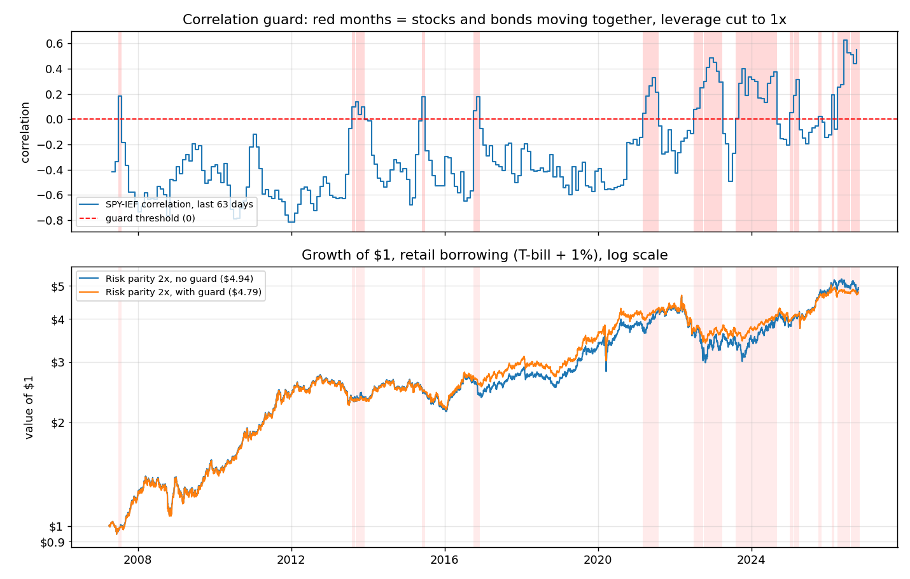

# Leveraged risk parity: how much leverage is too much?

A Python backtest of a **risk parity** portfolio (stocks, bonds, gold and commodities) run with leverage, with
realistic borrowing costs, trading costs and **margin calls**. Daily data, 2007 to October 2026.

**Question:** can a risk parity portfolio safely use leverage, and at what point does leverage stop helping?

**Short answer:** about 2x is the practical limit. Leverage raised returns up to about 3.5x, but drawdowns grew in step
(−36% at 2x, −51% at 3x). Each extra 1x of borrowing lowered the Sharpe ratio, because borrowing costs more than
the risk-free rate. Even with cheap, institutional-style borrowing (T-bill + 0.25%), levered risk parity earns more
than 60/40 but still does not beat its Sharpe ratio. Above about 3.25x, **margin calls** started forcing the
portfolio to sell near the bottom. At 4x they cut the annual return from 12.5% to 4.2%. And in 2022, when stocks and
bonds fell together, 2x risk parity lost 25%, more than a plain 60/40 portfolio. A simple "correlation guard" (no
borrowing when stocks and bonds have been moving together) cut that loss to 19%, but it was designed with hindsight
and reacted months late.

---

## 1. The idea in one story

A normal 60/40 portfolio puts 60% of the **money** in stocks. But stocks move about 3 times as much as mid-term bonds
(19.5% vs 6.9% volatility a year), so almost all of the portfolio's **risk** comes from stocks. Over 2007-2026,
stocks carried about 100% of 60/40's risk; the bonds slightly reduced it, because they tended to move the other way.
In practice, 60/40 is a stock portfolio with some bonds attached.

Risk parity gives each asset the same share of risk instead. Calm assets need more money to matter, so **bonds get
most of the money** (about 55% here) and stocks only about 16%. The result is very stable, but its return is low.

The usual solution is to **borrow** to scale the stable portfolio up to a useful return. This project tests that
step: how much leverage is safe once you pay for the borrowing and the broker can force you to sell?

## 2. Method

| | |
|---|---|
| **Assets** | SPY (US stocks), TLT (20+ year Treasuries), IEF (7-10 year Treasuries), GLD (gold), DBC (commodities) |
| **Data** | Yahoo Finance daily adjusted closes (dividends included), 2007-01-03 to 2026-10-16. 0 missing ETF prices; 2 missing T-bill days filled with the previous day |
| **Rebalancing** | First trading day of each month, at the close. Weights use **only data up to the previous day's close** (no lookahead; tested) |
| **Borrowing cost** | 3-month T-bill yield (^IRX) + 1% a year on the borrowed amount, charged daily. Spare cash (leverage below 1x) earns the T-bill rate |
| **Trading cost** | 5 basis points (0.05%) on every dollar traded |
| **Margin call** | If equity / total exposure falls below 25% (leverage above 4x), the position is forced down to 1x at that day's close. See [the margin model](#the-margin-model) below |

**Strategies**
1. **60/40**: 60% SPY, 40% IEF.
2. **Equal weight**: 20% in each asset.
3. **Risk parity 1x**: weight each asset by 1 / (its 60-day volatility), scaled to sum to 100%.
4. **Risk parity 1.5x and 2x**: the same mix, scaled up with borrowed money.
5. **Vol target 10%**: risk parity weights, with leverage reset each month so the *expected* volatility (from the
   last 60 days, including how the assets move together) is 10% a year. Leverage is kept between 0.5x and 3x.

### The margin model

- **The rule:** equity must stay at or above 25% of total exposure, so the most leverage allowed is 4x. It is checked
  once a day, at the close.
- **What happens on a margin call:** all positions are cut in the same proportion until exposure equals equity
  (1x), at that day's close, paying the normal 5 bp trading cost.
- **When it re-levers:** the portfolio **stays at 1x for the rest of the month**. It only goes back to its target
  leverage at the next monthly rebalance (the first trading day of the next month). If the margin call happens on a
  rebalance day, that day's rebalance is skipped.
- **The 4x case is a quirk of the rule, not of the market.** At a 4x target, equity is *exactly* 25% of exposure
  right after every rebalance. The portfolio starts on the margin-call line, so almost any down day triggers a forced
  sale. The 197 margin calls at 4x come from this, not from unusual markets.

## 3. Results (April 2007 to October 2026)

| Strategy | CAGR | Volatility | Sharpe | Sortino | Max drawdown | Calmar | Worst year | Longest recovery | Borrow cost/yr |
|---|---|---|---|---|---|---|---|---|---|
| 60/40 | 8.23% | 11.0% | **0.64** | **0.91** | −32.2% | 0.26 | −17.7% (2008) | 2.8 yrs | – |
| Equal weight | 6.63% | 8.5% | 0.62 | 0.88 | −21.5% | 0.31 | −9.9% (2022) | 3.7 yrs | – |
| Risk parity 1x | 5.75% | **7.0%** | 0.62 | 0.88 | **−18.8%** | 0.31 | −11.6% (2022) | **2.5 yrs** | – |
| Risk parity 1.5x | 7.19% | 10.5% | 0.57 | 0.81 | −27.7% | 0.26 | −18.5% (2022) | 3.7 yrs | 1.25% |
| Risk parity 2x | **8.52%** | 14.1% | 0.54 | 0.78 | −35.7% | 0.24 | −25.1% (2022) | 3.8 yrs | 2.50% |
| Vol target 10% | 7.67% | 11.2% | 0.58 | 0.81 | −21.8% | **0.35** | −11.8% (2022) | 3.8 yrs | 1.68% |

Sharpe and Sortino are measured above the T-bill rate. Trading costs were below 0.13% a year for every strategy. None
of these six strategies had a margin call. The vol-target strategy's leverage ranged from 0.72x to 2.89x and never
reached its cap or floor. All numbers are in [results.csv](results.csv).

### Stress periods (return over the period)

| Strategy | 2008 crisis (Oct 2007 – Mar 2009) | Covid crash (Feb – Mar 2020) | 2022 rate shock (calendar year) |
|---|---|---|---|
| 60/40 | **−31.9%** | −18.4% | −16.6% |
| Equal weight | −6.1% | −9.0% | −9.9% |
| Risk parity 1x | +7.7% | −5.7% | −11.6% |
| Risk parity 1.5x | +9.0% | −8.6% | −18.5% |
| Risk parity 2x | +9.7% | −11.4% | **−25.1%** |
| Vol target 10% | +11.9% | −11.8% | −11.8% |

The stress periods were chosen from well-known market dates (the S&P 500 peak and bottom, and calendar 2022), not by
looking at these results.

### Leverage curve: risk parity at 1x to 4x

| Leverage | 1x | 1.5x | 2x | 2.5x | 3x | 3.25x | 3.5x | 3.75x | 4x |
|---|---|---|---|---|---|---|---|---|---|
| CAGR, with margin rule | 5.75% | 7.19% | 8.52% | 9.72% | 10.79% | 10.32% | **11.41%** | 11.31% | **4.19%** |
| Max drawdown, with margin rule | −18.8% | −27.7% | −35.7% | −43.7% | −51.3% | −54.8% | −52.8% | −57.2% | −45.9% |
| Sharpe, with margin rule | 0.62 | 0.57 | 0.54 | 0.53 | 0.52 | 0.48 | 0.51 | 0.50 | 0.25 |
| Margin calls | 0 | 0 | 0 | 0 | 0 | 2 | 7 | 42 | 197 |
| CAGR, if no margin rule existed | 5.75% | 7.19% | 8.52% | 9.72% | 10.79% | 11.27% | 11.72% | 12.13% | 12.50% |
| Max drawdown, if no margin rule existed | −18.8% | −27.7% | −35.7% | −43.7% | −51.3% | −54.8% | −58.2% | −61.3% | −64.3% |

"With margin rule" is the real result. "If no margin rule existed" is a what-if where the broker never forces a sale,
which isolates the effect of borrowing cost and volatility drag. Above 3.25x the margin rule makes the drawdown
*smaller* (−45.9% at 4x instead of −64.3%), because being forced down to 1x stops the losses. But it also misses the
recovery, so the return collapses. Every 0.25x step is in [leverage_curve.csv](leverage_curve.csv).

**Why returns rise and then fall (volatility drag).** The yearly growth rate at leverage L is roughly:

> L × average return  −  (L − 1) × borrowing rate  −  L² × variance / 2

The first two terms grow in a straight line, but the last one grows with **L squared**: doubling leverage doubles the
return but *quadruples* the drag. This is because losses hurt compounding more than gains help it: a −50% year needs
+100% to get back to even. For this portfolio (5.8% average return, 2.5% average borrowing cost, 7% volatility), the
formula puts the peak at about 6.8x. Simulated without margin calls, CAGR peaks at 6.0x (14.1%).

Risk parity is so calm that **volatility drag alone does not turn returns down before 4x**. The orange line in the
chart below keeps rising. Inside 1x-4x, what breaks leverage is the **margin call**: the red "margin call zone" on
the chart, above 3.25x. At 3.25x, two forced sales near the bottom left it behind 3x. At 4x, the portfolio starts
exactly on the 25% margin line (see [the margin model](#the-margin-model)), gets forced out 197 times, and ends up
below 1x. Margin calls make you sell after the fall and miss the rebound.

### Sensitivity to borrowing cost

The main case borrows at T-bill + 1%, roughly what a retail broker charges. Big funds get leverage through futures,
whose built-in financing cost is close to the T-bill rate, so **T-bill + 0.25% is the "institutional / futures"
case**. The three levered strategies were rerun at four spreads ([borrow_sensitivity.csv](borrow_sensitivity.csv)):

| Strategy | Spread over T-bill | Case | CAGR | Sharpe | Max drawdown | CAGR vs 60/40 | Sharpe vs 60/40 |
|---|---|---|---|---|---|---|---|
| Risk parity 1.5x | 0% | no spread (theoretical) | 7.73% | 0.62 | −27.4% | −0.50 | −0.02 |
| Risk parity 1.5x | 0.25% | institutional / futures | 7.60% | 0.61 | −27.5% | −0.63 | −0.03 |
| Risk parity 1.5x | 0.5% | in between | 7.46% | 0.59 | −27.5% | −0.77 | −0.05 |
| Risk parity 1.5x | 1% | retail broker (main case) | 7.19% | 0.57 | −27.7% | −1.04 | −0.07 |
| Risk parity 2x | 0% | no spread (theoretical) | 9.60% | 0.62 | −35.3% | +1.37 | −0.02 |
| Risk parity 2x | 0.25% | institutional / futures | **9.33%** | 0.60 | −35.4% | **+1.10** | −0.04 |
| Risk parity 2x | 0.5% | in between | 9.06% | 0.58 | −35.5% | +0.83 | −0.06 |
| Risk parity 2x | 1% | retail broker (main case) | 8.52% | 0.54 | −35.7% | +0.29 | −0.10 |
| Vol target 10% | 0% | no spread (theoretical) | 8.45% | **0.65** | −21.8% | +0.22 | **+0.01** |
| Vol target 10% | 0.25% | institutional / futures | 8.25% | 0.63 | −21.8% | +0.02 | −0.01 |
| Vol target 10% | 0.5% | in between | 8.06% | 0.61 | −21.8% | −0.17 | −0.03 |
| Vol target 10% | 1% | retail broker (main case) | 7.67% | 0.58 | −21.8% | −0.56 | −0.06 |

60/40 for comparison: CAGR 8.23%, Sharpe 0.64, max drawdown −32.2%.

**Does leverage beat 60/40 once borrowing is cheap?** On **return**, yes: at the institutional spread, risk parity 2x
earns 1.1% a year more than 60/40, and vol target matches it while falling only −21.8% at its worst instead of −32.2%.
On **risk-adjusted return**, no, or only just. With free borrowing, levered risk parity's Sharpe goes back to the 1x
level (0.62), as theory says, because leverage scales return and risk equally. That is still just below 60/40's
0.64. Only vol target with zero spread edges past it (0.65), and that is too small a gap to mean much. Cheaper
borrowing barely changes the drawdowns: the big losses come from the assets falling (2022), not from the interest
bill.

### Checking the 2008 result

Vol target (+11.9%) beat risk parity 2x (+9.7%) over the 2008 crisis, even though it is a "less levered" version of
the same portfolio. `main.py` prints a month-by-month table for July 2007 to March 2009, with leverage, positions and
monthly returns. A summary:

| Month | Risk parity 2x: leverage | return | Vol target: leverage | return |
|---|---|---|---|---|
| 2007-10 | 2.00x | +6.4% | 2.10x | +6.7% |
| 2008-02 | 2.00x | +4.8% | 1.39x | +3.4% |
| 2008-09 | 2.00x | −3.2% | 1.48x | −2.3% |
| 2008-10 | 2.00x | **−15.2%** | 1.35x | −10.1% |
| 2008-11 | 2.00x | +13.3% | 0.96x | +6.4% |
| 2008-12 | 2.00x | +13.2% | 0.76x | +5.1% |
| 2009-01 | 2.00x | **−10.3%** | 0.75x | −3.9% |
| 2009-02 | 2.00x | −4.2% | 0.80x | −1.7% |

The volatility estimate only uses data up to the previous day. The code checks this for all 235 rebalances; for
example, the 2008-10-01 rebalance used the 60 daily returns from 2008-07-08 to 2008-09-30.

**Why vol target did better:** both strategies hold the same mix of assets, so the only difference is leverage.
Risk parity 2x stayed at 2x throughout, but vol target had already cut to about 1.4x by February 2008, as markets got
more volatile (Bear Stearns, the oil spike), and cut again to about 0.75x after the October crash. In risk parity
2x's three worst months (October 2008, January and February 2009) it lost 15.2%, 10.3% and 4.2%, against 10.1%, 3.9%
and 1.7% for vol target. Vol target gave some of that back by being below 1x in the strong November-December 2008
rebound. But avoiding big losses matters more than catching rebounds when returns compound, and it also paid less
interest.

## 4. Charts

**Growth of $1** (log scale; grey bands = 2008, Covid, 2022)


**Drawdowns**: how far each strategy is below its previous high


**Risk parity weights over time**: IEF and TLT together hold about half the money


**Vol-target leverage over time**: cut to 0.75x after the 2008 crash and Covid, below 1x for most of 2022


**Leverage curve** (red = margin call zone, above 3.25x)


**Correlation guard**: red months = stocks and bonds moving together, leverage cut to 1x (see section 6)


## 5. What broke in 2022, and why

Risk parity is a bet that **bonds rise when stocks fall**. From 2007 to 2021 that was true: the daily correlation
between SPY and TLT was −0.43, and in 2008 it was −0.48. That is why risk parity *made* money in 2008 while 60/40 lost
32%.

In 2022, inflation hit 9% and the Federal Reserve raised rates from about 0% to over 4% in one year. Rising rates push
bond prices down, so **bonds fell together with stocks**. The SPY-TLT correlation turned positive (+0.08), and in 2022:

| SPY | TLT | IEF | GLD | DBC |
|---|---|---|---|---|
| −18.2% | **−31.2%** | −15.2% | −0.8% | +19.3% |

Three things hit the levered risk parity portfolio at once:
1. **Its biggest holdings were the worst performers.** About 52% of the money was in TLT and IEF, which lost 31% and
   15%. The weights were set for calm bond markets, so the portfolio was most exposed exactly where the shock came.
2. **Leverage multiplied a loss that diversification was supposed to prevent.** 1x lost 11.6%, 2x lost 25.1%, worse
   than 60/40 (−16.6%).
3. **Borrowing got expensive.** The T-bill rate went from 0.03% to 4.26% during the year, so the cost of the borrowed
   half rose from about 1% to over 5% a year.

The vol-target version did much better (−11.8%). As volatility rose, it cut leverage from 1.78x in January to 0.97x by
May and 0.72x by December. That reaction cuts both ways: before Covid, after a calm 2019, it was **at 2.2x**, and
monthly rebalancing meant it only cut leverage in April, after the crash. Volatility targeting protects against slow
crises, not sudden ones.

## 6. Correlation guard: can a simple rule see 2022 coming?

> **Read this first:** this rule was designed **after seeing 2022**. Its 2022 result is therefore **not a true
> out-of-sample test**: I already knew stocks and bonds fell together that year. The rule was fixed before running it
> and was not tuned, but the idea itself came from hindsight.

**The rule (fixed in advance):** at each monthly rebalance, compute the correlation of daily SPY and IEF returns over
the last 63 trading days (about 3 months), using only data up to the previous day. If it is **above 0** (stocks and
bonds have been moving together), cut leverage to **1x** for that month: same mix of assets, no borrowing. Otherwise,
use the normal leverage. Vol target months that were already below 1x are left as they were; the guard only
removes borrowing. Applied to risk parity 2x and vol target 10%, at both 1% and 0.25% borrowing spreads.

The guard was on in **47 of 234 months (20%)**: briefly in 2007, 2013, 2015 and 2016, then most months from 2021 on
(2021: 5, 2022: 6, 2023: 8, 2024: 8, 2025: 4, 2026: 8).

| Strategy | Borrowing | Guard | CAGR | Vol | Sharpe | Sortino | Max DD | Calmar | Worst year |
|---|---|---|---|---|---|---|---|---|---|
| Risk parity 2x | retail 1% | no | 8.52% | 14.1% | 0.54 | 0.78 | −35.7% | 0.24 | −25.1% |
| Risk parity 2x | retail 1% | **yes** | 8.35% | 12.7% | **0.58** | 0.82 | **−27.4%** | 0.30 | **−18.9%** |
| Risk parity 2x | institutional 0.25% | no | 9.33% | 14.1% | 0.60 | 0.85 | −35.4% | 0.26 | −24.5% |
| Risk parity 2x | institutional 0.25% | **yes** | 9.00% | 12.7% | **0.62** | 0.89 | **−27.2%** | 0.33 | **−18.5%** |
| Vol target 10% | retail 1% | no | 7.67% | 11.2% | 0.58 | 0.81 | −21.8% | 0.35 | −11.8% |
| Vol target 10% | retail 1% | yes | 7.46% | 10.9% | 0.58 | 0.81 | −21.8% | 0.34 | −11.8% |
| Vol target 10% | institutional 0.25% | no | 8.25% | 11.2% | 0.63 | 0.88 | −21.8% | 0.38 | −11.7% |
| Vol target 10% | institutional 0.25% | yes | 7.97% | 10.8% | 0.62 | 0.87 | −21.8% | 0.37 | −11.7% |

**Stress periods**, return (max drawdown inside the period):

| Strategy | Borrowing | Guard | 2008 crisis | Covid crash | 2022 rate shock |
|---|---|---|---|---|---|
| Risk parity 2x | retail 1% | no | +9.7% (−23.0%) | −11.4% (−21.3%) | −25.1% (−35.7%) |
| Risk parity 2x | retail 1% | yes | +9.7% (−23.0%) | −11.4% (−21.3%) | **−18.9% (−27.4%)** |
| Risk parity 2x | institutional 0.25% | no | +10.8% (−22.7%) | −11.4% (−21.3%) | −24.5% (−35.4%) |
| Risk parity 2x | institutional 0.25% | yes | +10.8% (−22.7%) | −11.4% (−21.3%) | **−18.5% (−27.2%)** |
| Vol target 10% | retail 1% | no / yes | +11.9% (−15.7%) | −11.8% (−21.8%) | −11.8% (−19.6%) |
| Vol target 10% | institutional 0.25% | no / yes | +12.4% (−15.6%) | −11.8% (−21.8%) | −11.7% (−19.5%) |

**What it shows**
- **For risk parity 2x, the guard helped in 2022 but did not prevent the loss.** The 2022 loss fell from −25.1% to
  −18.9%, and the max drawdown from −35.7% to −27.4%. The Sharpe rose from 0.54 to 0.58, for 0.2% a year less return.
- **It switched on late.** In the first half of 2022, stocks and bonds both fell *over the months*, but their *daily*
  moves were still negatively correlated (−0.43 in January, −0.09 in May). The guard only switched on in **July
  2022**, after most of the bond losses.
- **For vol target it did nothing in 2022.** By July 2022, vol target had already cut itself below 1x because
  volatility was high, so the guard had nothing left to remove. Over the whole period it slightly lowered vol
  target's return.
- **It did not touch 2008 or Covid.** In both crises, bonds rallied while stocks fell (negative correlation), which is
  exactly when risk parity *wants* leverage.
- **It has a cost afterwards.** From 2023 to 2026 the correlation stayed positive in most months, so the guard kept
  risk parity at 1x through a strong recovery. That is why it ends with less money ($4.79 vs $4.94 at 2x retail).

**Robustness check only.** The same rule with thresholds of −0.2 and +0.2 is shown below
([guard_robustness.csv](guard_robustness.csv)). **These are not alternatives to choose from.** Threshold 0 is the
main result, fixed before running.

| Threshold | Months guarded | RP 2x retail: CAGR / Sharpe / Max DD / 2022 | Vol target retail: CAGR / Sharpe / Max DD / 2022 |
|---|---|---|---|
| −0.2 | 35% | 9.02% / 0.67 / −23.0% / −11.1% | 7.73% / 0.63 / −21.8% / −10.9% |
| **0 (main)** | **20%** | **8.35% / 0.58 / −27.4% / −18.9%** | **7.46% / 0.58 / −21.8% / −11.8%** |
| +0.2 | 11% | 8.39% / 0.56 / −30.8% / −22.6% | 7.55% / 0.58 / −21.8% / −11.8% |

The −0.2 threshold looks much better (Sharpe 0.67, above 60/40's 0.64). **This should not be trusted.** It looks
better mainly because it switched on in March 2022, when the correlation reached −0.18. That is exactly the kind of
result you get by tuning a rule to a crisis you have already seen. The honest reading is that the **direction** of
the result is the same for all three thresholds (a guard cuts the 2022 loss for 2x risk parity), but how much it
helps depends heavily on a setting that was chosen with hindsight.

## 7. Known limitations

- **US ETF data from 2007 only.** One country's stocks and bonds, through one long bond bull market (2007-2020) and
  one sharp rise in interest rates. The history starts in 2007 because of when the ETFs launched (DBC in 2006). That
  is about 20 years: only a few major crises, and only one where stocks and bonds fell together. Other countries or
  decades (e.g. 1970s inflation) could look very different.
- **TLT and IEF move almost together** (correlation 0.91), so the portfolio really has about 4 independent bets, and
  the bond risk counts almost double.
- **Simple margin model.** One fixed 25% maintenance level, checked only at the daily close, forced sales at the
  close with no extra slippage, and a fixed rule for re-levering (the next monthly rebalance). Real brokers can raise
  margin requirements during a crisis and liquidate during the day, which would make the high-leverage results worse.
- **Monthly rebalance only.** Weights, leverage and the correlation guard change once a month. Between rebalances, leverage drifts with the
  market and the portfolio cannot react to a crash. This is a big part of why vol target was still at 2.2x when Covid
  hit, and why its leverage cuts always arrive after the shock.
- **Simple risk parity.** Inverse volatility ignores correlations when setting weights. Full risk parity (equal risk
  contribution using the covariance matrix) could give different numbers.
- **Costs are estimates.** A flat 5 bp per trade, and borrowing at T-bill + a fixed spread; the spread is tested from
  0% to 1% in [Sensitivity to borrowing cost](#sensitivity-to-borrowing-cost). ETF expense ratios are already in the
  prices. Taxes are ignored.
- **Parameters are not optimised** (60-day window, 10% target, monthly rebalancing). Other choices would change the
  numbers somewhat. Nothing was tuned to make the results look better.

## 8. Interview takeaways

1. **Leverage does not improve the Sharpe ratio; it lowers it if borrowing costs more than the risk-free rate.**
   Levering risk parity from 1x to 2x raised CAGR from 5.8% to 8.5% but lowered the Sharpe from 0.62 to 0.54, because
   every borrowed dollar pays 1% more than T-bills. With free borrowing the Sharpe goes back to the 1x level (0.62),
   because leverage scales return and risk equally. So the cost of financing decides whether leverage is worth it:
   at institutional rates (T-bill + 0.25%), 2x risk parity earns 1.1% a year more than 60/40, but still does not beat
   its Sharpe (0.64). The case for it is diversification across crises, not a higher Sharpe.
2. **Correlation is the key assumption.** The strategy is a bet that bonds hedge stocks. That worked in 2008 (+9.7%
   at 2x while 60/40 lost 32%) and failed in 2022 (−25.1%), when an inflation shock made the correlation positive.
   Leverage turns a broken correlation assumption into a big loss. A simple guard that stops borrowing when stocks
   and bonds start moving together cut the 2022 loss at 2x from 25% to 19%. But it switched on months late, and it
   was designed with hindsight, so it is a sensible risk control, not a proven edge.
3. **Path matters more than the average: margin calls and volatility drag.** Two portfolios with the same average
   return can end very differently. Drag grows with leverage squared, and a margin call locks in the loss at the
   bottom. At 4x, forced selling cut the CAGR from 12.5% to 4.2%. "How much leverage" is really a question about
   surviving the worst path, not about the average.
4. **Volatility targeting is a lagging control.** Cutting leverage when volatility rises helped a lot in the slow
   2022 sell-off (−11.8% vs −25.1%). But it was at its *highest* leverage going into Covid, after a calm year. Like
   most risk models built on recent data, it reacts after the shock rather than predicting it.

## 9. Files and how to run

```bash
pip install -r requirements.txt
python main.py            # on Windows: py main.py   - runs everything (about 10 seconds after the first download)
python -m pytest tests    # 8 tests
```

| File | What it does |
|---|---|
| `data.py` | Downloads the ETF prices and the T-bill yield once, saves them in `data/`, cleans them and prints a summary |
| `strategies.py` | Sets each strategy's monthly mix ($ per asset per $1 of equity) from past data only; also the correlation guard |
| `backtest.py` | Simulates each day: market moves, interest, margin check, monthly rebalance; also runs the leverage curve |
| `metrics.py` | CAGR, volatility, Sharpe, Sortino, drawdown, Calmar, worst year, longest recovery, stress periods |
| `plots.py` | Saves all charts to `charts/` |
| `main.py` | Runs everything in order (data, backtests, metrics, borrowing-cost sensitivity, the 2008 check, charts) and writes `results.csv`, `leverage_curve.csv` and `borrow_sensitivity.csv`. `results.csv` also has the levered strategies at the other borrowing spreads (column "Borrow spread %") and with the correlation guard; `guard_robustness.csv` has the threshold check |
| `tests/test_strategies.py` | Weights add up to 100% (or to the leverage), the calmest asset gets the most money, no lookahead in weights, correlation or the backtest, a crash triggers a margin call down to 1x, the guard only ever removes borrowing |

Delete the CSV files in `data/` to download fresh data.
